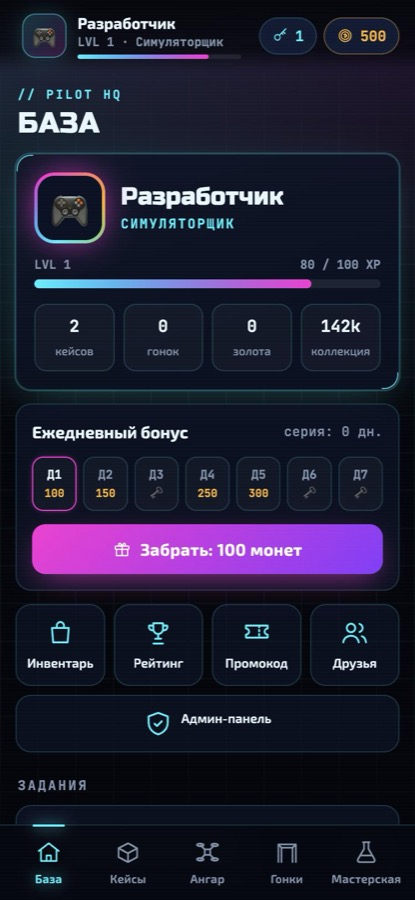
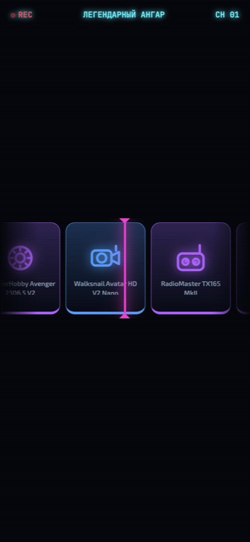
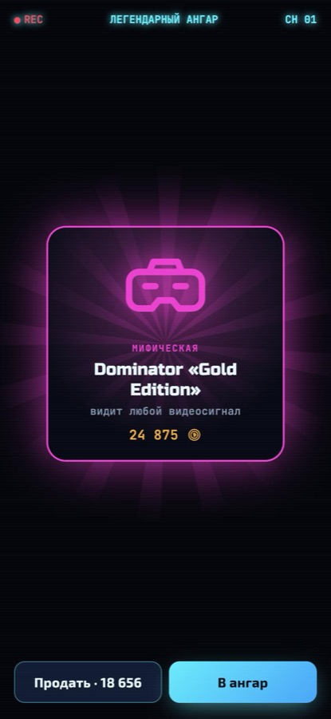
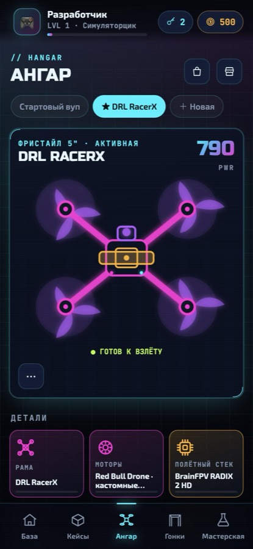
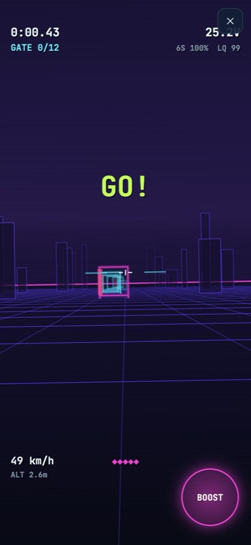

# 🚁 FPV-Drons — Telegram-игра про FPV-дроны

> **EN:** A Telegram bot + Mini App game about FPV drones: open loot crates with ~140 real parts
> (frames, motors, stacks, DJI / Walksnail / HDZero / analog video, goggles, radios), build a drone
> where compatibility matters, upgrade it in the workshop and race it yourself in a first-person
> canvas mini-game with a ghost of the track record. Neon OSD-style UI, admin panel, promo codes.
> Python (FastAPI + aiogram 3 + SQLite) and vanilla JS, no build step.

Бот: [@fpvdronsplaybot](https://t.me/fpvdronsplaybot)

<p>
  
  
  
  
  
</p>

## Что внутри

**Кейсы.** 11 кейсов (вупы, синевупы, фристайл 5", лонг-рейндж 7", гонки, видео, пульты, легендарный и
мифический), ~140 реальных моделей шести редкостей. Шансы открыты прямо в кейсе. Открытие — аналоговые
помехи «поиск сигнала», лента-рулетка с вибро-тиками и раскрытие с лучами по редкости. Экономика выверена:
средняя ценность выпадения — 80–85 % цены кейса (проверяется тестом).

**Сборка дрона.** Шесть слотов (рама, моторы, стек, видео, пропы, батарея) плюс комплект пилота — очки и
пульт. Всё как в жизни: детали должны подходить по классу (вуп / синевуп / 5" / 7"), а очки — принимать
видеосистему (DJI Goggles не видят HDZero). Из качества деталей считаются скорость, отклик, прочность,
время полёта, чистота картинки, задержка и плавность управления. SVG-схема дрона окрашена по редкости
деталей, пропы крутятся.

**FPV-гонка от первого лица.** Canvas-мини-игра: ведёшь дрон пальцем через неоновые ворота, BOOST
быстрее, но съедает батарею. Характеристики сборки реально меняют полёт: на аналоге — помехи, на цифре —
задержка картинки (ввод запаздывает на латентность видео + пульта), слабая батарея не дотянет длинную
трассу, хрупкая рама не переживёт крашей. OSD как в очках: таймер, напряжение по банкам, скорость, высота,
искусственный горизонт. 7 трасс, рекорды и **«призрак»** лучшего заезда. Рейты и экспо как в Betaflight.

**Античит.** Мини-игра в браузере, поэтому сервер не верит цифрам. Он строит ту же трассу по seed
(генератор портирован с JS на Python побитово) и проверяет запись полёта: время идёт вперёд и совпадает с
заявленным, дрон не летит быстрее, чем позволяет сборка, заявленные ворота действительно пролетены, а
«пробитые» стойки засчитаны как краши. Плюс физические пределы — не быстрее возможного, не дольше батареи
и реального времени, лимит оплачиваемых заездов в сутки. Отклонённый заезд нельзя переотправить.

**Износ и ремонт.** Пропы и батарея изнашиваются каждый заезд, краши бьют раму, пропы и моторы. Хорошая
рама бережёт остальное. Сломанная деталь не даст взлететь, пока не починишь.

**Мастерская.** Апгрейд: поставь до 6 деталей ради дорогой цели (шанс = ставка / цель, максимум 80 %,
стрелка на кольце шанса). Контракт: 5 деталей одной редкости → 1 на ступень выше.

**Прогресс.** Опыт и 9 рангов (от «Симуляторщика» до «Легенды DRL»), награды за уровни, ежедневный бонус
с серией на 7 дней, 4 случайных дневных и 4 недельных задания, рефералы (бонус другу и тебе, ещё один —
когда друг дорастёт до 5 уровня), рейтинги по уровню, золоту и стоимости коллекции, живая лента редких дропов.

**Админка** (только для `ADMIN_IDS`, во вкладке мини-аппа и командами бота): статистика, глобальные
события (удача ×N, награды за гонки ×N), поиск игрока, монеты ±, уровень и ранг, личная удача, подарки
(монеты, опыт, любая деталь, ключи от кейсов, готовые дроны-комплекты), бан, бесплатный ремонт, изъятие
детали, промокоды с лимитом и сроком, рассылка всем игрокам, журнал действий. Игрок получает уведомление
о подарке в Telegram.

## Стек и устройство

- **Python 3.13**: FastAPI (API + статика мини-аппа) и aiogram 3 (long polling) в одном процессе, SQLite (aiosqlite).
- **Фронтенд**: ванильный JS-модули без сборки, Canvas 2D для гонки, SVG для дрона и иконок.
- Авторизация мини-аппа — проверка подписи `initData` Telegram (HMAC-SHA256).
- Все записи — через одну транзакцию с asyncio-замком: монеты не спишутся дважды при параллельных запросах,
  уведомления уходят только после успешного COMMIT.

```
app/
  game/       чистая логика: сборка и характеристики, шансы, мастерская, гонки, прогресс, задания
  store/      SQL-доступ (функции принимают соединение → работают внутри общей транзакции)
  services/   сценарии: кейсы, инвентарь, ангар, мастерская, гонки, промо, админка, награды
  api/        FastAPI-роуты, схемы запросов, авторизация initData, лимиты частоты
  bot/        команды бота и уведомления
data/         каталог: items.json, cases.json, kits.json, tracks.json
webapp/       мини-приложение: js/views (экраны), js/game (движок гонки), css
tests/        89 тестов, покрытие ~94 %
```

## Запуск локально

```bash
python3 -m venv .venv && .venv/bin/pip install -r requirements-dev.txt
cp .env.example .env            # BOT_TOKEN, WEBAPP_URL (https), ADMIN_IDS
.venv/bin/python -m app
```

Без Telegram (браузер на http://localhost:8000, вход под dev-пользователем):

```bash
DEV_MODE=1 BOT_TOKEN= ADMIN_IDS=1 .venv/bin/python -m app
```

Тесты:

```bash
.venv/bin/python -m pytest -q --cov=app
```

## Развёртывание

`docker compose up -d --build` — контейнер слушает только `127.0.0.1:8096`, база в `./storage`.
Мини-приложению нужен HTTPS: в `deploy/` лежат пример блока Caddy и systemd-юнит обратного SSH-туннеля
на VPS (для домашнего сервера за NAT).

## Команды бота

`/start` (с рефкодом `ref_<id>`), `/play`, `/profile`, `/daily`, `/promo КОД`, `/top`, `/invite`, `/help`.
Для админов: `/admin` (сводка и кнопка админки), `/give ID монеты`.

---

Названия моделей — реальные товарные знаки их владельцев и используются только как игровые предметы;
изображения деталей — собственные SVG-силуэты. Лицензия MIT.
